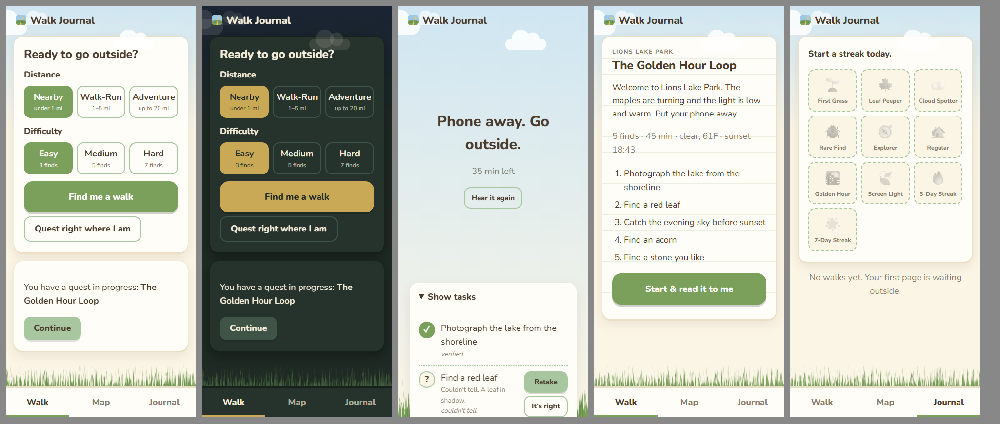

# Walk Journal 🌾

**A quest-giving outdoor journal. The screen is the shortest part.**

Walk Journal finds real walks near you, writes a seasonal, place-specific photo quest, and reads it aloud so your phone can go in your pocket. When you snap proof, it checks the place, the time, and what's in the photo, all on your own laptop with Gemma. Every walk you finish becomes a pin on your map and a page in your journal.

> Built for the **DEV Hacktoberfest 2026 Open-Source AI Challenge, Week 1: Touch Grass**: *"Build something with open-weight models or open-source AI that gets people off the screen and into the world."*



## How it gets you outside

1. Tap **Find me a walk**. Pick a distance (Nearby / Walk-Run / Adventure) and a difficulty (Easy / Medium / Hard).
2. **SerpApi** finds real parks, trails and lakes nearby. **Gemma** picks the best 3 *for right now*: season, minutes until sunset, weather.
3. Pick one. **Gemma writes the quest**: 3–7 photo tasks, a deadline that ends before sunset, and a short spoken intro.
4. Tap **Read it to me** and **ElevenLabs reads it aloud**, or turn on "Read quests aloud as soon as I start" (off by default). The screen says *"Phone away. Go outside."* and nothing else.
5. Your phone comes out only to snap a task. **Take photo** records live GPS and time inside the app. **Choose from gallery** uses the time and GPS saved in the photo itself.
6. Base Camp checks the proof: **right place** (GPS radius), **right time** (quest window), **right thing** (Gemma vision).
7. Finish with a journal note and mood. You get badges, your streak, and your screen time: *"92 seconds on screen. 48 minutes outside."*

### Swap this task

Every unfinished photo task has a **Swap this task** button: Easy quests get 1 swap, Medium and Hard get 2 (separate from Hard's one skip for the rare find). Gemma writes one replacement from the same quest context (season, time of day, walk mode, the place's real features). The replacement goes through the same rules as the original quest: no invented place features, nothing unsafe, no task types already in this quest. A place-specific or rare task is replaced with another of the same kind. There's no point penalty, and the quest notification updates to match.

### Walk from here

No destination needed. **Walk from here** turns a normal walk around your home into a quest:

- Your current location becomes the start point. Gemma writes **seasonal and time-of-day tasks only**. Tasks that mention a park, trail, lake or landmark are dropped by code.
- A photo passes the place check if it's within your chosen distance of the start: Nearby = 1 mi, Walk-Run = 5 mi, Adventure = 20 mi.
- **Medium and Hard need one verified photo at least 300 m from the start**, so you actually walk. The phone shows how far you are from the start. A walk that never gets that far is saved in your journal but earns no points, badges or streak day.
- Every walk from here adds to one **Home walks** pin on your map, with a visit count.

### Notifications

All off until you turn them on in **Settings**:

- **Daily walk reminder** at a time you pick (default 5 PM).
- **Evening journal reminder** (default 8 PM), sent only if you haven't written a journal note today.
- **Quest progress**: when a quest starts, one notification lists your tasks and updates itself as you go ("2 of 5 done"), with a **Take photo** action that opens the camera for the next task. It uses a single tag, so it replaces itself instead of stacking.

They're real Web Push messages sent from Base Camp with VAPID keys from `.env` (`python -m basecamp.app.push --generate` creates them). **Notifications are text only, never photos or locations.** Code refuses to send a payload that contains coordinates, a place, or a photo link. **iPhone:** add Walk Journal to your Home Screen first (Share → Add to Home Screen, iOS 16.4+); iOS only allows notifications for Home Screen web apps.

The app measures its own screen time with the Page Visibility API. Target: under 2 minutes per quest.

## Architecture

```
PHONE (PWA in the browser)                         LAPTOP = "Base Camp"  (python -m basecamp)
- Get a quest, hear it read aloud        <──────>  FastAPI
- In-app camera + live GPS at the shutter          - Ollama + gemma4:e4b: ranks walks, writes quests,
- Works offline at the park:                         checks photos (vision), reads tracker screenshots,
  quest + audio cached, captures saved               moderates shared skies
  to IndexedDB, synced in order later              - SerpApi client (Google Maps engine, 7-day SQLite cache)
                                                   - ElevenLabs TTS (mp3 cache)
        HTTPS via Cloudflare quick tunnel          - astral (sunrise/sunset, offline) + Open-Meteo weather
        so camera + GPS work on the phone          - SQLite: places, quests, captures, badges
                                                   - Sentry gen_ai tracing (optional)

SKY GALLERY (public, separate service on Render)   gallery/  +  render.yaml
- FastAPI + MongoDB Atlas (SQLite fallback)
- Receives ONLY sky photos you choose to share: resized to 1280 px, EXIF stripped, city-level location
```

**Code supplies facts, Gemma only writes.** Code computes the season, hemisphere, sunset, minutes left, weather, and which features a place really has, then hands Gemma a facts object. Gemma's JSON (schema-enforced by Ollama) goes through `enforce_rules()`:

- **No invented features.** If a task mentions a lake, bridge, fountain or anything else that isn't in the SerpApi data for that place, the task is dropped and replaced.
- **Safety filter.** No climbing, entering water, touching or feeding wildlife, picking flowers, or leaving the trail.
- Right task count per difficulty, a place-specific task where required, one **rare find** + one **tracker** task on Hard (with one skip).
- No daytime sky tasks after dark. The deadline is clamped to end before sunset.
- No repeats of task types from your last 3 quests.

If Gemma is unreachable, Base Camp still works: quests come from a code-written fallback built from the same seasonal banks and rules, and photo checks wait as "pending" until Gemma is back.

## Setup

**You need:** Python 3.11+, [Ollama](https://ollama.com), and optionally [cloudflared](https://developers.cloudflare.com/cloudflare-one/connections/connect-networks/downloads/) for HTTPS to your phone.

```bash
git clone https://github.com/nikithakls17-sys/Walk-Journal-.git
cd Walk-Journal-
pip install -r requirements.txt

ollama pull gemma4:e4b
cp .env.example .env          # add SERPAPI_KEY and ELEVENLABS_API_KEY (both optional, see below)

python -m basecamp            # checks Ollama, starts Base Camp, opens a tunnel, prints a QR code
```

Scan the QR code with your phone. "Add to Home Screen" installs it as an app.

| Key | What it unlocks | Without it |
|---|---|---|
| `SERPAPI_KEY` | Real nearby parks and trails | Use **Walk from here** |
| `ELEVENLABS_API_KEY`, `ELEVENLABS_VOICE_ID` | Natural quest voice | The browser's built-in speech |
| `SENTRY_DSN` | `gen_ai` traces of every Gemma call | No tracing |
| `GALLERY_URL`, `GALLERY_TOKEN` | Sharing skies to the public gallery | Share button stays hidden |
| `VAPID_PUBLIC_KEY`, `VAPID_PRIVATE_KEY` | Notifications (`python -m basecamp.app.push --generate`) | Notification toggles explain they're not set up |

Install cloudflared with `winget install --id Cloudflare.cloudflared` (Windows) or `brew install cloudflared` (macOS). Without it, Base Camp prints your Wi-Fi URL, but phone browsers only allow camera + GPS over HTTPS.

### Deploy the Sky Gallery (Render + MongoDB Atlas)

1. Create a free MongoDB Atlas cluster and copy its connection string.
2. On Render: **New → Blueprint**, point it at this repo. It reads `render.yaml`.
3. Set `MONGODB_URI` in the Render dashboard. Copy the generated `GALLERY_TOKEN`.
4. In Base Camp's `.env`, set `GALLERY_URL=https://<your-service>.onrender.com` and `GALLERY_TOKEN=...`.

Without `MONGODB_URI` the gallery falls back to SQLite. That works locally, but Render's free tier has no persistent disk, so skies would reset on redeploy.

## What leaves the laptop, and what never does

| Goes to | What | Why |
|---|---|---|
| SerpApi | Place searches, e.g. "parks" near your coordinates | Find real walks |
| ElevenLabs | Only the quest text | Read it aloud |
| Open-Meteo | Coordinates of the chosen place | Current weather for the quest |
| OpenStreetMap Nominatim | Your home coordinates rounded to ~1 km, once at setup | Your city name |
| Sky Gallery | Only sky photos you choose to share, with city, date, time, season | The public gallery |
| Your phone's push service (Google, Apple or Mozilla) | Encrypted notification text: reminder wording, quest title and task list. Never photos or locations | Notifications, if you turn them on |
| Sentry (optional) | Model name, latency, token counts, outcome. **No prompts, photos, or responses.** | Tracing |

**Never leaves:** quest photos, tracker screenshots, journal notes, mood, exact locations, visit history. They live in `data/` on your laptop. Every stored photo is re-encoded with its EXIF and GPS metadata stripped. Before a sky is shared, Gemma checks locally that it's mostly sky with no people, faces, or readable text. If it finds any, sharing is blocked.

## Proof verification

| Check | How | Who |
|---|---|---|
| Right place | GPS at the shutter must be within the place radius (400 m default, 1500 m for big parks), plus GPS accuracy as tolerance (capped at 150 m) | Code |
| Right time | Capture time must fall between quest start and deadline | Code |
| Gallery photos | Base Camp reads the photo's EXIF time and GPS **before** stripping it. If both are there, the photo gets the same place and time checks as a camera photo and can be fully verified. Where the phone is *now* is never used for a gallery photo | Code |
| Photo quality | Too dark, washed out, or blurry → ask for a retake instead of guessing (blur check skipped for sky and water) | Code (Pillow) |
| Right thing | Gemma vision gets the photo + the task's `verify` text → `{match, confidence, what_i_see, reason}`. Passes at confidence ≥ 0.6 | Gemma |
| Tracker goal | Gemma reads the watch/band screenshot → `{date, distance_mi, steps, duration_min}`. Code checks the date is today and the distance meets the goal | Gemma + code |

When Gemma is unsure, the task shows **"Couldn't tell"**. You can retake it, or self-confirm it with a different, honest ✋ icon. Self-confirmed tasks never count toward badges.

A gallery photo with no EXIF time or GPS still gets Gemma's content check. If it matches, the task is marked **"time/place not confirmed"** with a dashed ◐ icon. It completes the task (5 points, like a self-confirm), but never counts toward badges or the 300 m rule. Taking a photo in the app afterwards upgrades it to verified.

### Honest limits

- Gemma can tell "this is a lake", not "this is *that* lake". The location check covers that.
- Phone clocks, GPS and EXIF data can be spoofed. This is a personal motivation app, not an anti-cheat system.
- Screen time measures time in Walk Journal only, not your whole phone.
- Reminders come from Base Camp, so the laptop has to be on and running Base Camp at reminder time.
- The free Cloudflare quick tunnel gets a new URL each run. Notifications belong to the URL they were turned on from, so after a restart, open the new link and turn them on again (a named Cloudflare tunnel gives a stable URL).
- Some phones and browsers remove location data when you pick a photo for a web page. Those photos show up honestly as "time/place not confirmed".
- Offline captures are verified when you're back online. Time and place were recorded at the shutter, so the check is still valid later.

## Evaluation

`eval/run_eval.py` runs labeled test photos (real finds plus wrong ones: a leaf for "acorn", an indoor shot for "sky", a blurry photo) through the real verifier and writes **[EVAL.md](EVAL.md)** with correct accepts, correct rejects, false accepts, false rejects, "couldn't tell", and the average time per check.

```bash
# put photos in eval/photos/ (names in eval/labels.csv), then:
python -m eval.run_eval
```

## Badges

First Grass · Leaf Peeper · Cloud Spotter · Rare Find · Explorer · Regular · Golden Hour · Screen Light (< 60 s on screen) · 3-Day Streak · 7-Day Streak. All are awarded by code, from verified tasks only.

## Prize categories

| Category | How Walk Journal uses it |
|---|---|
| **Gemma** | `gemma4:e4b` runs locally in Ollama with JSON-schema outputs. It ranks walks, writes quests, verifies photos (vision), reads tracker screenshots, and moderates shared skies |
| **Render** | Hosts the public Sky Gallery (`render.yaml` Blueprint) |
| **SerpApi** | Google Maps engine finds real parks, trails and lakes, cached for 7 days |
| **ElevenLabs** | Reads every quest aloud so the phone goes in your pocket |
| **MongoDB Atlas** | Stores the Sky Gallery |
| **Sentry** | `gen_ai.invoke_agent` + `gen_ai.chat` spans for every Gemma call: model, latency, tokens, outcome (quest generated / photo match / no match / couldn't tell) |

## Development

```bash
pip install pytest
python -m pytest tests     # 78 tests: core loop, rules, task swaps, walk from here, gallery photos + EXIF, notifications, places, journal, sky gallery, tracing, eval
```

`BUILD_LOG.md` is the bug diary: what broke, why, and the fix.

## What's next

Friends and shared quests, public profiles, travel quests, a native app, and running Gemma fully on the phone.

## Commits after the deadline

None so far. Any commit made after Oct 11, 11:59 PM PDT will be listed here.

## License

MIT, see [LICENSE](LICENSE). Nunito font is under the SIL Open Font License (`basecamp/static/fonts/LICENSE-Nunito.txt`). Map data © OpenStreetMap contributors.
